# ChargingPile
智慧充电桩小程序 
亮点：腾讯地图与距离计算、分时电价计费、多条件自动结束、充电业务模拟、自动结算与收益分配、ECharts多维分析、三角色业务闭环；
角色：用户、运营商、管理员；

所有源码均本人开发，项目是前后端分离的，所有的项目都具备了完整的业务逻辑，不仅仅局限于基础的增删改查（CRUD）操作，系统亮点众多。

本文注重于计算机毕业设计选题指导，列出题目均有源码， 大家可以去【公众号】(毕业终点站)获取或者加我【qq】(2112698948)提意见(别忘记Star哟)。备注：git

声明：仅用于学习使用，请勿用于任何商业行为！

1.系统非商用，非开源，非无偿。

2.由本人开发，如需源码，请联系以下方式，qq:2112698948。

3.项目有很多，并未全部上传，如果未找到想要的，可直接咨询。

# 智慧充电桩管理系统

> uni-app 微信小程序 + Vue 3 管理后台 + Spring Boot 3 服务端，管理员、运营商、用户三角色分开作业：用户在小程序里找站、扫码、充电、支付，运营商维护自有站点和充电桩，管理员负责审核、电价配置与平台侧数据。

做这套系统起因挺实在——身边的充电桩项目大多只做到"列表 + 下单"，真到计费这一步就含糊过去了。电费按时段浮动、跨零点怎么算、余额不够怎么停、充满怎么自停，这些才是充电业务里最容易被问住的地方。所以这套东西把重点放在了**分时电价计费**和**多条件自动结束**上，站点、充电桩、订单、收益、故障几条线也都做成了能实际点得动的样子。

## 技术栈

| 层次 | 技术选型 |
| --- | --- |
| 架构 | B/S、MVC、前后端分离、微信小程序端 + 管理后台 + 运营商后台 |
| 服务端 | Java 17、Spring Boot 3、Spring MVC、MyBatis-Plus、MySQL、JWT |
| 管理后台 | Vue 3、Vite、Element Plus、Vue Router、Pinia、Axios、ECharts |
| 小程序 | uni-app、Vue 3、Pinia、微信小程序 API、腾讯地图、扫码与定位 |
| 开发工具 | IDEA、Maven、HBuilderX、微信开发者工具、Node.js |

## 功能亮点

**1. 腾讯地图与距离计算**
小程序调用定位拿到经纬度，用球面距离公式算出各站点离用户多远，按距离排序展示附近充电站，站点详情页可以直接跳转到站导航。列表里同时给出空闲桩数和营业时间，不用点进去才知道有没有位。

**2. 分时电价计费**
电价按峰、平、谷三档配置，每档分别设电价单价和服务费单价。计费时按充电起止时间落在哪些时段里分段累加，跨时段、跨午夜的订单会自动拆开算，不是拿一个平均价乘一下了事。

**3. 多条件自动结束**
可充时长由四个条件共同决定：用户选定的计划时长、设备剩余电量、充电桩的最大充电时长、钱包余额。按时长充电到点即停，"充满自停"模式则按设备剩余电量推算结束点，两种模式在确认页就能切换。

**4. 充电业务模拟**
按充电桩额定功率乘以充电时长估算电量，充电过程中实时展示进度和预计费用。支付走余额支付和模拟支付两条路，演示环境不用真扣钱也能把整个流程走完。

**5. 自动结算与收益分配**
订单完成后自动生成消费明细和收益明细，按配置的比例把收益拆成运营商部分和平台部分，运营商的收益管理页可按站点、按结算周期核对每一笔。

**6. ECharts 多维分析**
平台和运营商两套视图分开看数据：订单与充电量趋势、站点类型占比、充电桩状态分布、用户增长、充值金额、收益排行，运营商只能看到自己名下站点的那一份。

**7. 三角色各管一摊**
管理员审核站点、配电价、管账号和内容；运营商维护自有站点和充电桩、处理故障、看收益；用户在小程序里完成找站、扫码、充电、支付、评价。三者数据打通，权限互相隔离。

## 系统角色与界面

### 登录入口

管理员和运营商共用同一个后台入口，登录时选择角色进入对应菜单，账号密码加图形验证码。

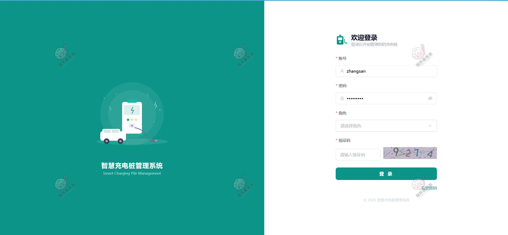

### 一、用户端（微信小程序）

**首页**
顶部搜索框按站点名称和地址检索，下方四个快捷入口分别是扫码充电、附近站点、我的订单、钱包充值。附近充电站卡片直接标出空闲桩数和总桩数，往下是热门资讯流，带浏览量和发布时间。

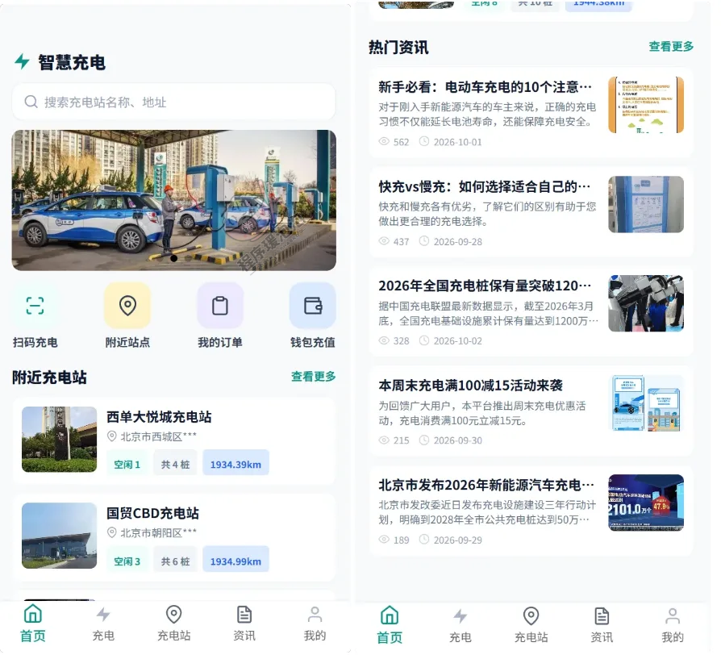

**扫码充电与充电确认**
左图是充电页：扫码入口之外还留了手动输入桩编号和上传二维码图片两条兜底路径，输入 `XD-DC-001` 后即返回所属站点和实时状态，下方单独一块展示充电中的订单。右图是确认页，桩信息把快充慢充、额定功率、最大充电时长、是否支持充满自停都摆出来；选择设备会带上电池总容量和当前电量（如 48.0 / 61.5 kWh、78.0%）；充电模式可选 1–4 小时按时长充电，或改为充满自停。

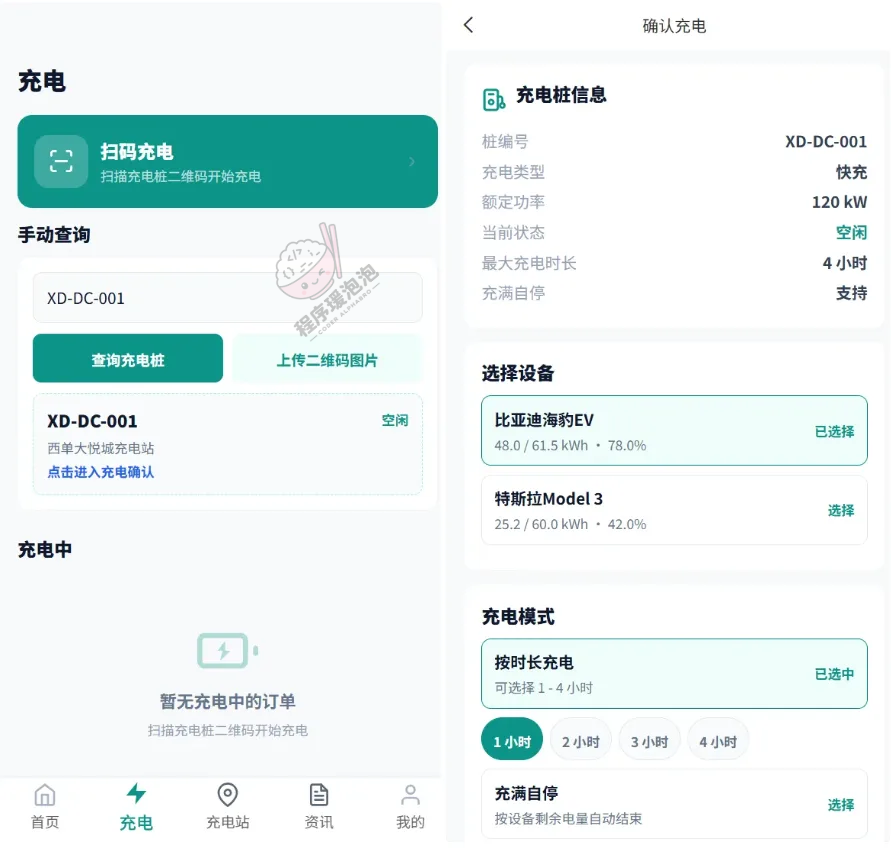

**充电站地图**
接入腾讯地图，站点按经纬度打点，上方按全部、快充、慢充三类筛选。卡片显示距离、空闲桩数、营业时间，右下角"导航到站"直接唤起地图导航。右图是导航视图，定位当前位置后可查看路线。

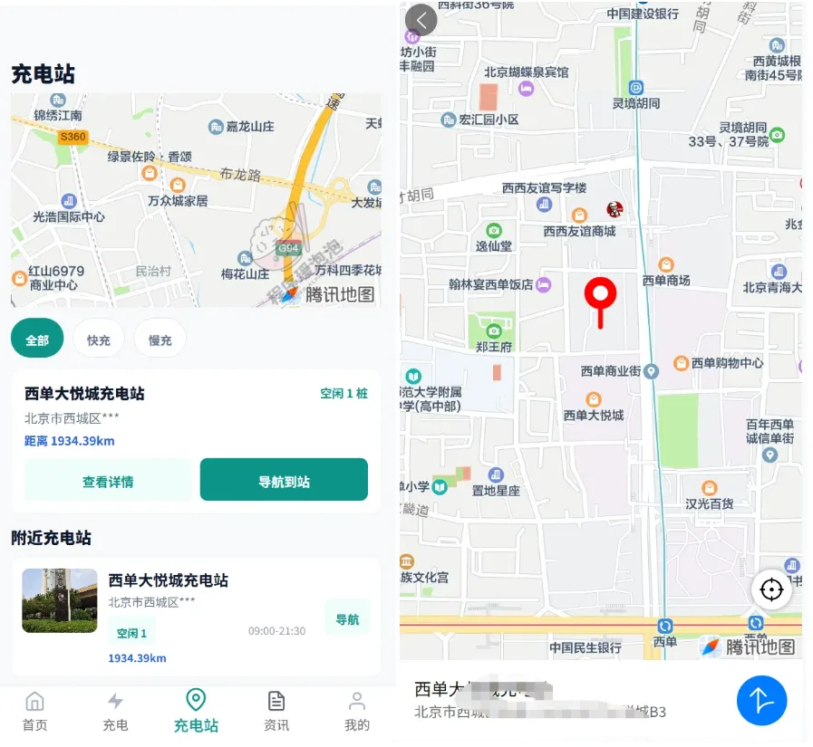

**资讯与评论**
资讯按行业动态、充电指南、优惠活动、政策法规分类，支持标题搜索。详情页可收藏、写评论和回复，评论数单独统计。

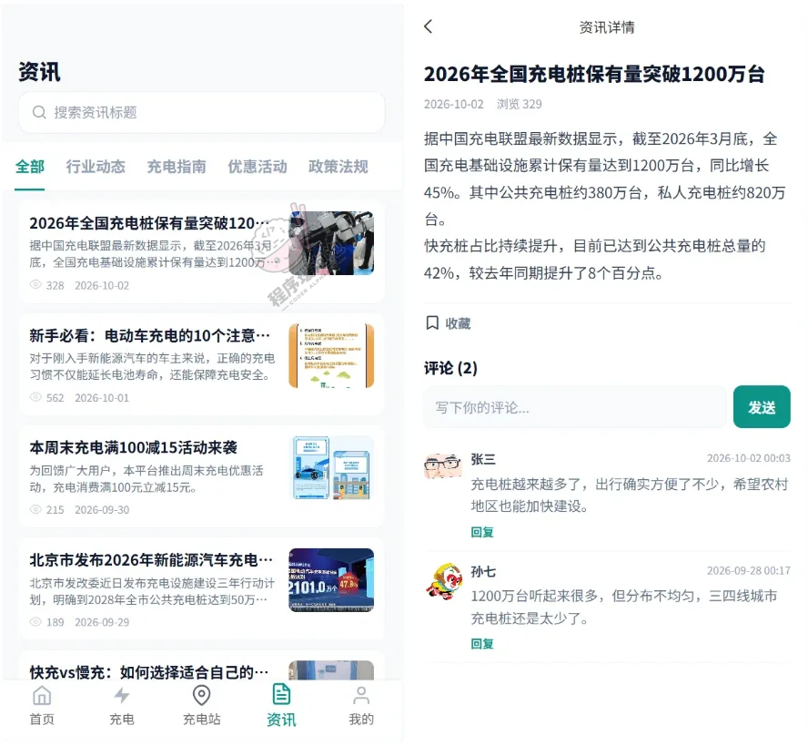

**个人中心与订单**
个人中心分充电服务和互动记录两组，我的钱包、我的设备（维护电池总容量和当前电量，供充电时长计算使用）、我的收藏、我的评论、我的评价都在这里。订单页按全部、充电中、待支付、已完成、已取消分状态，支持按日期区间筛选，每条记录给出充电站、充电时长和总费用，完成后可评价。

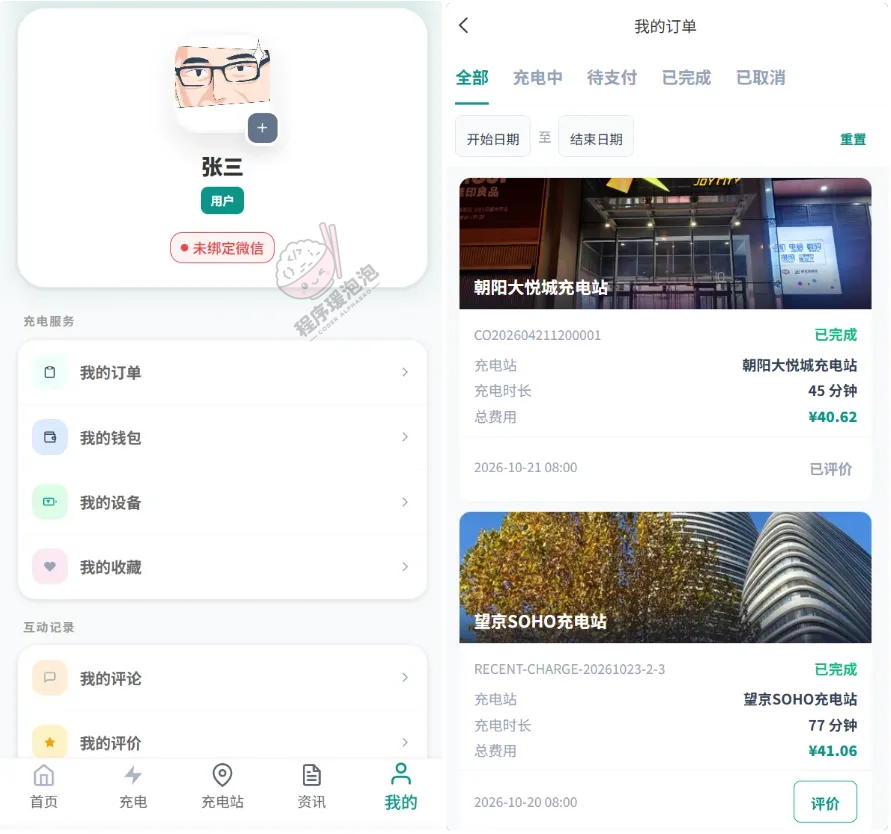

### 二、运营商端（Web 后台）

**运营看板**
六张卡片把名下站点数、充电桩数（含故障桩）、今日订单、今日收益、故障桩数量、今日充电量一次列清，下面是近 7 天订单趋势和近 7 天收益趋势两张折线图，右侧环形图看充电桩状态分布——空闲、充电中、故障、离线各占多少。

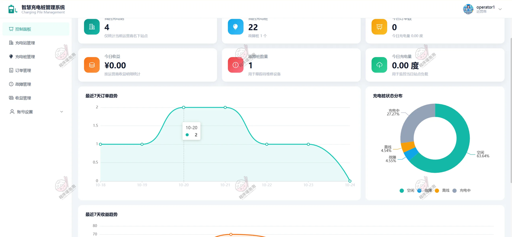

**充电站管理**
按站点名称和审核状态查，列表带站点类型、营业时间、详细地址、充电桩数量（如"8/空闲6"）、审核状态和审核备注。新站点提交后要等平台审核，通过才能对外展示。

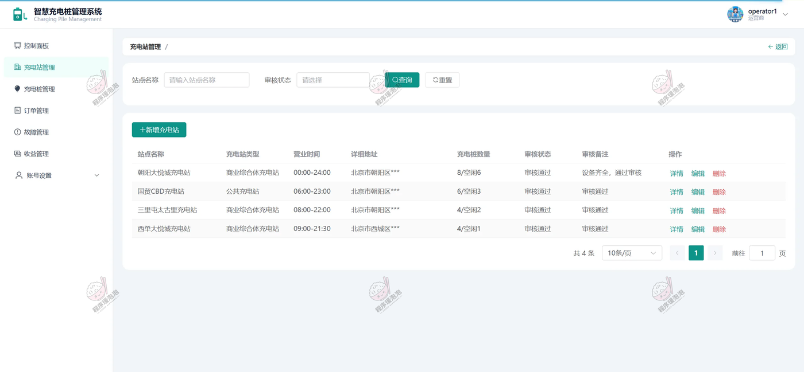

**充电桩管理**
按桩编号、所属站点、状态三个条件筛选，支持新增和批量删除。列表把充电类型、额定功率、接口类型、最大充电小时、是否支持充满自停、当前状态都摊开：快充桩 120 kW 和 150 kW 为国标 DC 接口，慢充桩 7 kW 为国标 AC 接口，单桩最长可充 4 小时。状态可在空闲、充电中、故障、离线之间更新。

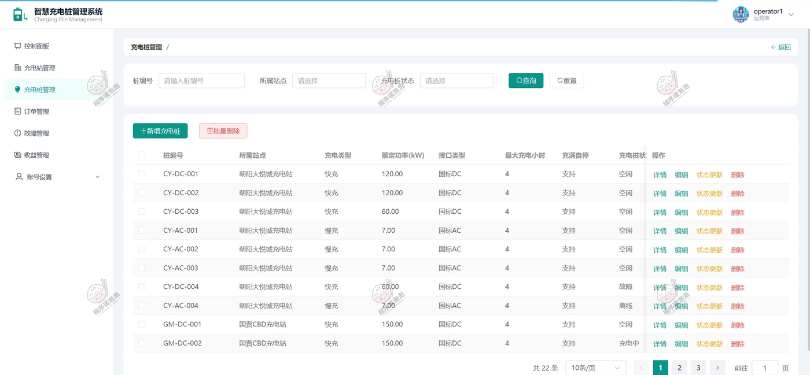

**订单管理**
只显示名下站点的充电记录，按订单号、充电站、订单状态和时间区间组合查询。每条订单给出起止时间、充电量（度）、总费用和订单状态，点详情可看费用拆分明细。

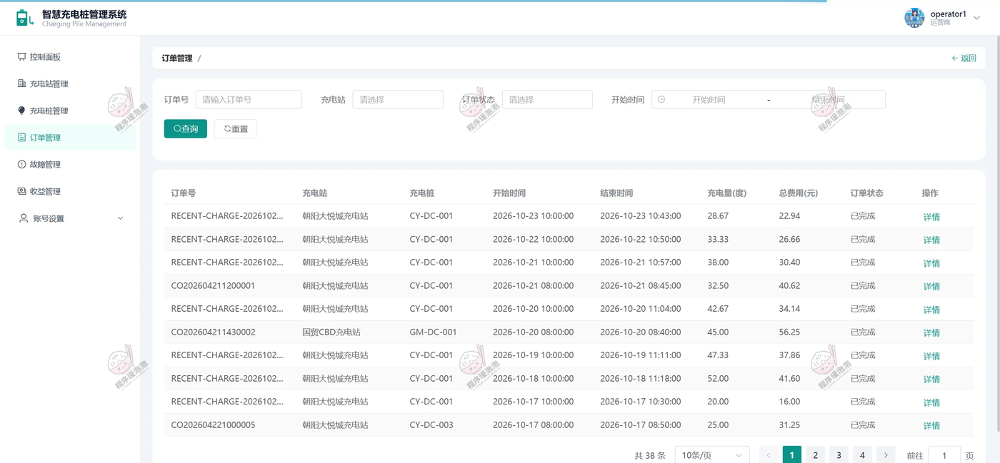

**故障管理**
记录报修的充电桩、故障描述和当前状态，处理完在维修备注里写清原因和处理方式，维修时间自动回填。状态为"待维修"的记录会同时反映到看板的故障桩数量上。

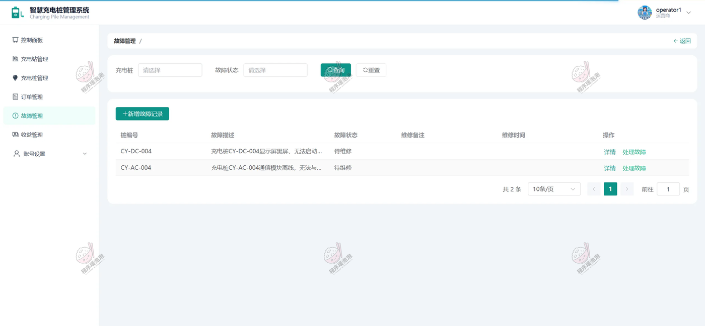

**收益管理**
顶部四张卡片：收益总额、本月收益、今日收益、收益明细条数。可按充电站和结算时间查询，趋势图支持按日、按周、按月切换，右侧柱状图是名下单站的收益排行，一眼看出哪座站在赚钱。

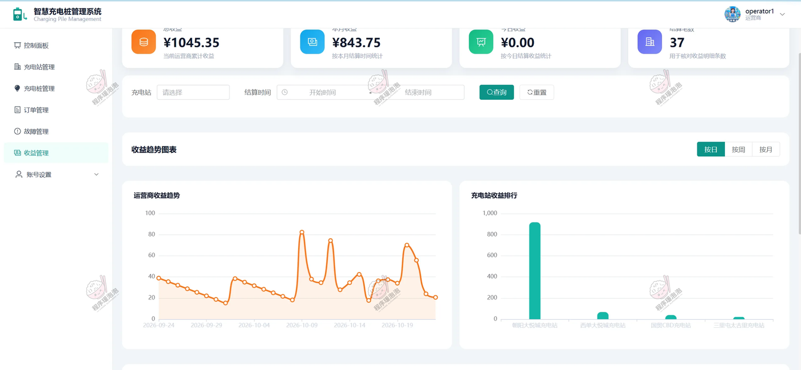

### 三、管理员端（Web 后台）

管理员菜单比运营商多出内容管理、数据分析和系统管理三块：充电站管理下分站点列表、站点审核、站点类型，订单管理下分充电订单和充值订单，数据分析分充电数据分析、收益分析、用户分析、数据可视化，系统管理包含管理员账号、用户账号、电价配置和操作日志。

**运营商管理**
维护入驻运营商资料——账号、名称、联系人、联系电话、营业执照号，可启用、禁用或删除账号，禁用后该运营商无法登录后台。

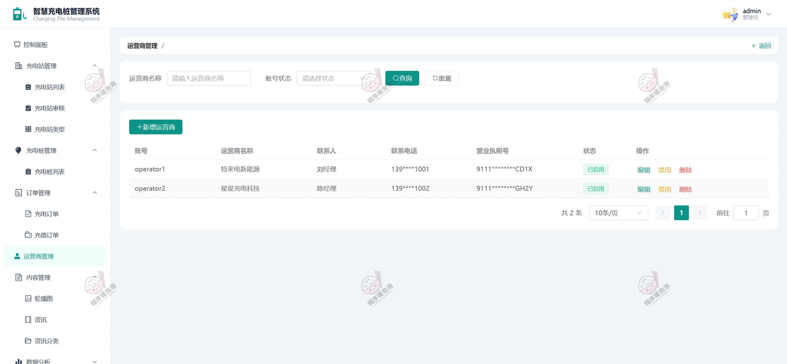

**资讯管理**
小程序资讯流的内容来源。按标题和分类查询，列表带封面、摘要、浏览量和创建时间，发布后小程序端实时可见。

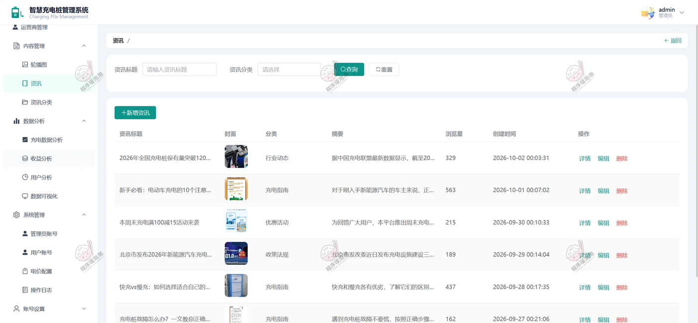

**电价配置**
分时电价就在这张表里配。谷时段（22:00–07:00）电价 0.35 元/度、服务费 0.10 元/度；平时段（07:00–10:00、15:00–18:00、21:00–23:00）0.65 / 0.15；峰时段（10:00–15:00、18:00–21:00）1.05 / 0.20。时段首尾相接覆盖全天，跨零点的谷时段会拆成两段配置，这也是计费能算准跨午夜订单的前提。

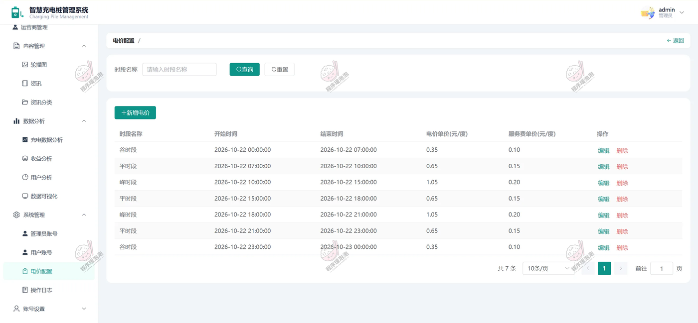

## 说明

- 文档展示 15 张截图，需要了解更多，请联系我。
- 截图中的站点、订单、用户均为演示数据，地图与支付走的是腾讯地图接口和模拟支付通道。
- 系统按 B/S 架构部署，服务端 Spring Boot 3 + MySQL，后台 Vue 3 打包后由 Nginx 托管，小程序端用 HBuilderX 编译发布。
